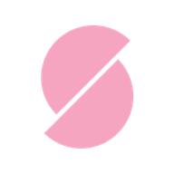

# TigerSlicer

A 3D printing slicer for FDM and resin printers, in one app.

[Download](https://github.com/tiggy0808/TigerSlicer/releases/latest) · [What's new](CHANGELOG.md) · [Report a bug](https://github.com/tiggy0808/TigerSlicer/issues/new/choose) · [Build from source](docs/BUILDING.md)

TigerSlicer is my personal slicer. It is built on [OrcaSlicer](https://github.com/OrcaSlicer/OrcaSlicer) and
keeps most of it (tree supports, scarf seams, a large printer library), without the
account and cloud features, plus the features below.

## Features

- **Resin (MSLA) printing in the same app.** Pick an Elegoo, Phrozen or generic MSLA printer and
  TigerSlicer slices with the [mslicer](https://github.com/connorslade/mslicer) engine, then exports a native
  printer file (Chitu `.ctb`, Elegoo `.goo` or NanoDLP) or sends it to an Elegoo or other ChiTu-board
  printer on your network. Generate supports, hollow the model and drill drain holes in the Supports
  workspace (View menu), and step through the exact image of every layer in the preview.
- **Auto slice.** One button: tell it what the print is for (Structural, Fast or Quality for filament;
  Low, Medium or High supports for resin) and it picks the profile, adds supports only where they are
  needed and slices. For resin it can hollow the model and add drain holes as well.
- **Brick layers.** Every other inner wall is printed half a layer higher, like bricks in a wall, so the
  walls lock into each other and parts are stronger between layers.
- **Fin supports.** A third support type next to Normal and Tree, for parts printed tilted on an edge
  or corner: thin walls under the part with small tines that snap off afterwards, optionally with
  holes to save filament. Auto puts them under the whole part; manual only where you paint support.
- **Calibration builder.** One tool for every calibration print: temperature, pressure advance,
  retraction, flow ratio, print speed, acceleration, jerk or input shaping. Choose the range and step,
  then print a tower with the values raised on its bands, or a grid of labelled copies. Use your own
  model if you like, and save setups to run again.
- **One filament profile per material.** PLA, PETG, ABS, ASA, PC, nylons, PPS, PEEK and the rest,
  each with carbon and glass fibre versions, tuned once and offered on every printer instead of a
  list of brands.
- **Independent tool layer heights.** On a multi-tool printer, each tool can print at its own layer
  height, so a fine nozzle and a fast nozzle work on the same print at their own pace.
- **Full Spectrum colour mixing.** Mix new colours from the filaments you have loaded and paint them onto
  a model. TigerSlicer builds them from the real filaments layer by layer.
- **Printer connections in one tab.** Your physical printers and their network connections have their own
  tab next to Prepare and Preview.
- **No account, no cloud.** No sign-in, no cloud preset sync, and TigerSlicer itself doesn't contact
  any server when it starts. Your presets stay on your computer.
- **Its own look.** A pink-and-black theme throughout, a new startup screen, and a native-looking Mac icon.

## Download

Get the latest version from the [Releases page](https://github.com/tiggy0808/TigerSlicer/releases/latest).

| Platform | File | Notes |
|---|---|---|
| Windows 10/11 (x64) | `TigerSlicer-<version>-win64-Setup.exe` | Installer, no admin rights needed. A portable `.zip` is also available. |
| macOS (Apple Silicon) | `TigerSlicer-<version>-macos-arm64.dmg` | Open it and drag TigerSlicer into Applications. |

Neither build is code-signed yet, so the first launch shows a warning:

- **Windows:** SmartScreen says "Windows protected your PC". Click **More info → Run anyway**.
- **macOS:** right-click TigerSlicer in Applications and choose **Open**, then **Open** again.

Settings are stored in `%APPDATA%\TigerSlicer` on Windows and `~/Library/Application Support/TigerSlicer`
on macOS, and are kept when you upgrade.

There are no Linux builds. macOS builds are for Apple Silicon only.

## Building from source

See [docs/BUILDING.md](docs/BUILDING.md) for Windows and macOS build steps.

## Reporting bugs and contributing

Found a bug? [Open an issue](https://github.com/tiggy0808/TigerSlicer/issues/new/choose) with the
TigerSlicer version, your printer and, if you can, the project file. See [CONTRIBUTING.md](CONTRIBUTING.md)
before sending a pull request, and [SECURITY.md](SECURITY.md) to report a security problem.

## Credits and license

TigerSlicer is free software under the [GNU Affero General Public License v3](LICENSE.txt).

It stands on the work of others:

- [OrcaSlicer](https://github.com/OrcaSlicer/OrcaSlicer) by SoftFever and contributors, which builds on
  [Bambu Studio](https://github.com/bambulab/BambuStudio) by Bambu Lab and
  [PrusaSlicer](https://github.com/prusa3d/PrusaSlicer) by Prusa Research, which in turn grew out of
  [Slic3r](https://github.com/slic3r/Slic3r) by Alessandro Ranellucci.
- [mslicer](https://github.com/connorslade/mslicer) by Connor Slade (GPL-3.0), the resin slicing engine.
- Fin supports are ported from an OrcaSlicer pull request by
  [abehrman](https://github.com/OrcaSlicer/OrcaSlicer/pull/15839), whose design follows Slant3D's support
  fins and Matthew Trahan's [Support Fins](https://github.com/gittrahan/support-fins) (MIT).
- Brick layers follow the Brick Layers post-processing scripts by Roman Tenger (TenTech) and Everson
  Siqueira (GeekDetour).

TigerSlicer is an independent project and is not affiliated with or endorsed by any of them.
